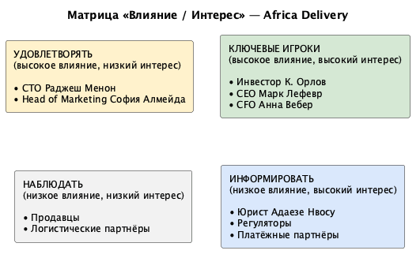

# Stakeholder Matrix — Africa Delivery

## 1. Таблица стейкхолдеров

| Стейкхолдер | Роль | Что ему важно (интересы) | Влияние (1–10) | Интерес (1–10) | Приоритет при конфликте | Как общаться |
|---|---|---|---|---|---|---|
| К. Орлов | Инвестор, единственный акционер | Запуск 15 октября, «не падает», 40% рынка за 3 года, данные в стране, продавцам платить день-в-день, максимально дёшево | 10 | 9 | 1 — решающий голос | Короткий письменный отчёт (1 страница), личные встречи |
| Анна Вебер | CFO | Бюджет $5k/мес на инфраструктуру, комиссия платежей < 2,5% GMV, нет долгих обязательств, нужны цифры TCO и стоимости заказа | 8 | 8 | 2 — вето по деньгам | Письменные расчёты, таблицы, коммерческие предложения |
| Марк Лефевр | CEO | Успешный запуск без повторения ошибок Jumia, чёткое разделение MVP и «потом» | 8 | 8 | 3 — арбитр «продукт vs сроки» | Встречи, email, сводки статуса |
| Раджеш Менон | CTO | Микросервисы, Kubernetes, Oracle, build-not-buy, масштаб на 10M с первого дня | 7 | 7 | 4 — технический авторитет, но без бюджета | Синхронные встречи, черновики ADR до встречи в Найроби |
| Адаезе Нвосу | Внешний юрист | Комплаенс NDPR/POPIA/KICA, детали регуляторики даст через 4–6 недель | 6 | 6 | 5 — блокирует решения по данным | Письма, отдельные встречи, вопросы в письменном виде |
| София Алмейда | Head of Marketing | Кампания уже оплачена, обещания в креативах (доставка день-в-день, миллион покупателей, SMS на 410k номеров) | 5 | 6 | 6 | Email, брифинги по продукту |
| Solution Architect | Архитектор / зам. CTO | Защитимое решение, запуск в срок в рамках бюджета | 6 | 9 | 7 — рекомендация, которую надо защитить | Все каналы |
| Том Брэдли | Product Manager (уволился) | Оставил список из 29 функций «всё P0» | 2 | 2 | 8 — голос отсутствует, остался только список | — |
| Продавцы | Внешние | Быстрые выплаты, простой онбординг без сложного кабинета | 3 | 6 | 9 — учитывать, но не блокируют | Через продакт-исследование (пока не проведено) |
| Покупатели | Внешние | Доверие, быстрая доставка, низкая цена | 2 | 7 | 10 — учитывать, но не блокируют | Через метрики продукта |
| Регуляторы (NDPC, ODPC, InfoReg SA) | Внешние | Локализация данных, согласие на маркетинг, лицензии | 7 | 4 | 11 — жёсткие внешние ограничения | Через юриста |

**Как читать приоритет:** чем меньше число, тем громче голос в споре. Орлов решает, Вебер может остановить любой счёт свыше $500, Лефевр разруливает конфликты «продукт против сроков», Менон формирует техническую повестку, но не распоряжается деньгами. Юрист не «голосует», но её выводы по локализации данных — это внешняя стена, которую нельзя обойти архитектурным решением.

## 2. Диаграмма «Влияние / Интерес»

Источник диаграммы: `stakeholder-matrix.puml`.

### Как читать эту карту

- **Ключевые игроки** (высокое влияние, высокий интерес) — Орлов, Лефевр, Вебер. Именно перед ними предстоит защищать решение в Найроби.
- **Удовлетворять** (высокое влияние, низкий интерес) — Менон и маркетинг. Их держим в курсе, но не даём формировать бюджетные решения. Менон ждёт от меня черновик ADR до встречи, чтобы зайти «согласованными».
- **Информировать** (низкое влияние, высокий интерес) — юрист, регуляторы, платёжные партнёры. Они не принимают продуктовых решений, но их ограничения становятся требованиями.
- **Наблюдать** (низкое влияние, низкий интерес) — продавцы и логистические партнёры на старте. Их не игнорируем, но глубокое исследование откладываем до пост-MVP.

## Assumptions

- Влияние и интерес оцениваются на момент 12 августа 2026 года, до встречи в Найроби.
- Позиция уволившегося Product Manager учитывается только через его список функций (артефакт 4), без возможности уточнения.
- Регуляторы рассматриваются как внешние ограничения, а не как участники переговоров.
