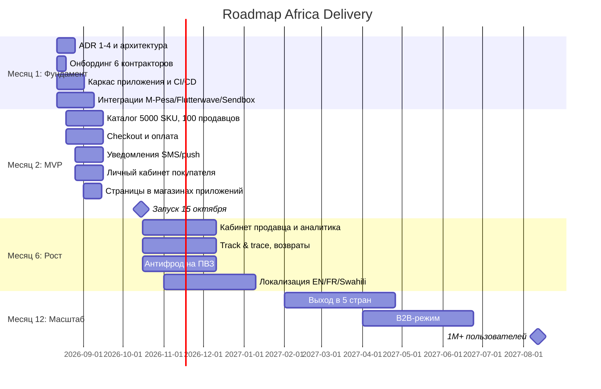

# Roadmap — Africa Delivery

Четыре контрольные точки. Отражение в виде Gantt — на рисунке `roadmap.png` (исходник `roadmap.puml`), ниже — Mermaid-версия.

## Контрольные точки

| Точка | Scope | Команда | Инфраструктурная стоимость |
|---|---|---|---|
| Месяц 1 (12 авг – 11 сен) | ADR 1–4, каркас, CI/CD, старт интеграций | 6 контракторов | $1,2k/мес (план), лимит $5k |
| Месяц 2 / MVP (15 октября) | Каталог, поиск, заказ, оплата, уведомления, кабинет покупателя, дашборд | 6 контракторов | $2,7k → $3,6k/мес (месяцы 2–3), лимит $5k |
| Месяц 6 (12 янв – 11 фев 2027) | Кабинет продавца, track & trace, возвраты, антифрод ПВЗ, локализация | 6 контракторов + возможен найм | $4,2k/мес, резерв $0,8k — в лимите $5k |
| Месяц 12 | 5 стран, B2B, 1M+ пользователей | Команда растёт по выручке | До $13,5k/мес при 1M — только в пределах нового лимита, утверждённого CFO |

Функции месяца 6 — это код внутри того же монолита и той же инфраструктуры. Они не требуют новых серверов, поэтому в лимит $5k укладываются. Стоимость растёт от числа активных пользователей, а не от числа функций.

## Бюджет инфраструктуры помесячно

Лимит CFO — $5 000/мес на первые 6 месяцев (12 августа 2026 – 11 февраля 2027, артефакт 6). В лимит считаем всё, за что платим ежемесячно, кроме транзакционных pass-through расходов: облако af-south-1, кенийскую serving-копию, нигерийского локального провайдера, DR, GSLB и инструменты эксплуатации.

Правило резерва: в каждом месяце не меньше 15% лимита ($750) не распределяется. Это запас на запусковые пики, учения failover и инциденты. Плановый потолок — $4 250/мес. Тратить резерв можно только с уведомлением CFO. Бюджетные алерты стоят на $4 000 (80%) и $4 750 (95%), у автоскейлинга жёсткий максимум нод.

| Месяц | Период | Активные пользователи (конец месяца) | Облако af-south-1 + Кения + DR/GSLB | Нигерия (локальный провайдер) | Инструменты (наблюдаемость, CI, WAF) | Итого план | Лимит CFO | Резерв |
|---|---|---|---|---|---|---|---|---|
| 1 | 12.08 – 11.09 | 0 (dev/stage) | $0,65k | $0,20k | $0,35k | $1,20k | $5,0k | $3,80k |
| 2 | 12.09 – 11.10 | 0 (prod, нагрузочный тест, бета продавцов) | $1,60k | $0,60k | $0,50k | $2,70k | $5,0k | $2,30k |
| 3 | 12.10 – 11.11 (запуск 15.10) | 60k | $2,20k | $0,80k | $0,60k | $3,60k | $5,0k | $1,40k |
| 4 | 12.11 – 11.12 | 100k | $2,25k | $0,85k | $0,60k | $3,70k | $5,0k | $1,30k |
| 5 | 12.12 – 11.01 | 130k | $2,50k | $0,90k | $0,60k | $4,00k | $5,0k | $1,00k |
| 6 | 12.01 – 11.02 | 150k (потолок в лимите) | $2,70k | $0,90k | $0,60k | $4,20k | $5,0k | $0,80k |
| Итого 1–6 | | | | | | $19,4k | $30,0k | $10,6k |

Модель стоимости после запуска: ≈ $2,6k постоянной части + $10,9 на каждую 1 000 активных пользователей в месяц. При 1M это даёт $13,5k/мес — столько же, сколько облако и инструменты монолита в TCO-модели ($11,8k + $1,7k). TCO-модель считает весь год 1 по уровню конца года, то есть консервативно.

Месяцы 7–12 — прогноз, который требует нового лимита:

| Месяц | Активные пользователи | Итого план | Запрашиваемая ступень лимита | Резерв |
|---|---|---|---|---|
| 7 | 250k | $5,3k | $6,5k | $1,2k |
| 8 | 400k | $7,0k | $8,5k | $1,5k |
| 9 | 550k | $8,6k | $10,5k | $1,9k |
| 10 | 700k | $10,2k | $12,0k | $1,8k |
| 11 | 850k | $11,9k | $14,0k | $2,1k |
| 12 | 1 000k | $13,5k | $16,0k | $2,5k |

### Решение CFO о новом лимите (открыто, срок — 12 января 2027)

- Кто решает: CFO Анна Вебер. Инвестор — в копии, потому что цель «1M к концу года 1» исходит от него.
- Когда: на гейте месяца 5, до 12 января 2027. К этому моменту есть три месяца фактических данных после запуска: счёт, активные пользователи, стоимость заказа.
- Что прошу: ступенчатый лимит из таблицы выше. Каждая следующая ступень открывается, только когда (а) активные пользователи дошли до порога ступени и (б) инфраструктурная стоимость заказа за прошлый месяц не выше плановой.
- Рост выручки сам по себе лимит не меняет. Пока нет письменного решения CFO, действует $5k/мес — даже если выручка растёт быстрее плана.
- Варианты для CFO: А) утвердить ступени (рекомендую); Б) продлить $5k — тогда держим потолок ~150k активных пользователей (лист ожидания, сдерживание платного привлечения), а active-active и рост переносятся; В) промежуточный фиксированный лимит $8,5k — потолок ~400k активных пользователей.
- Если до 15 октября рост пойдёт быстрее плана и 150k будут достигнуты раньше месяца 6, это внеочередное решение CFO по тем же правилам, а не автоматическое превышение.

## Что сокращено из списка Product Manager

Категории: MVP (входит в запуск 15 октября), 6 мес (второй релиз), 12 мес (рост), Бэклог (неопределённо/позже).

| # | Функция (артефакт 4) | Судьба | Период |
|---|---|---|---|
| 1 | Каталог товаров, категории, атрибуты | MVP (упрощённо: 5000 SKU, без «неограниченных» атрибутов) | MVP |
| 2 | Полнотекстовый поиск с опечатками (5 языков) | MVP (поиск, опечатки — через Typesense/OSS) | MVP |
| 3 | Голосовой поиск (суахили, хауса) | Бэклог | 12 мес+ |
| 4 | ИИ-рекомендации | Бэклог | 12 мес+ |
| 5 | Live-стримы с покупкой | Бэклог (маркетинг обещает к 17 окт — конфликт, см. противоречие C-03) | 6–12 мес |
| 6 | Чат покупатель-продавец с автопереводом | Бэклог | 12 мес |
| 7 | Оценки и отзывы (фото/видео) | 6 мес | 6 мес |
| 8 | Онбординг продавца через WhatsApp | MVP (через WhatsApp Business API) | MVP |
| 9 | Онбординг продавца через USSD | Бэклог | 12 мес |
| 10 | Кабинет продавца с аналитикой | 6 мес | 6 мес |
| 11 | Оплата (M-Pesa, Flutterwave, Paystack, карта, перевод, наличные) | MVP — только M-Pesa + Flutterwave; карта/наличные/перевод — поэтапно | MVP → 6 мес |
| 12 | Рассрочка на 4 платежа | Бэклог | 12 мес |
| 13 | Мультивалютный кошелёк | Бэклог | 12 мес |
| 14 | Лояльность на криптотокенах | Бэклог (по просьбе инвестора — «изучить, не к октябрю» | 12 мес+ |
| 15 | Колесо фортуны | Бэклог | 6–12 мес |
| 16 | Флеш-распродажи с таймерами | MVP (базовый таймер, маркетинг требует к неделе запуска) | MVP |
| 17 | Динамическое ценообразование (парсинг Jumia) | Бэклог | 12 мес+ |
| 18 | Отслеживание заказа, карта курьера, ETA | MVP — базовый статус; живая карта и ETA до минуты — 6 мес | MVP → 6 мес |
| 19 | Доставка в ПВЗ с видеофиксацией | 6 мес (видеофиксация — после проверки законности, артефакт 4 примечание) | 6 мес |
| 20 | Возвраты и рефанды 30 дней | MVP — базовый возврат/рефанд; «мгновенный» рефанд — 6 мес | MVP → 6 мес |
| 21 | ML-антифрод | 6 мес (базовые правила), ML — 12 мес | 6–12 мес |
| 22 | B2B-режим | 12 мес | 12 мес |
| 23 | Партнёрская/реферальная программа | 6–12 мес | 6–12 мес |
| 24 | Офлайн-заказ через USSD/SMS | 6 мес (маркетинг нацелен на 30–40% рынка) | 6 мес |
| 25 | PWA + native iOS + native Android (паритет) | MVP — PWA + native Android; iOS и полный паритет — 6–12 мес | MVP → 12 мес |
| 26 | Админ бэк-офис | 6 мес (базовый KYC/модерация после запуска) | 6 мес |
| 27 | Публичный GraphQL API | Бэклог | 12 мес |
| 28 | Дашборд руководства в реальном времени | MVP (базовый, обновление раз в минуту) | MVP |
| 29 | Тёмная тема | Бэклог | 12 мес |

Итог по 29 функциям: в MVP входит 10 функций (1, 2, 8, 11, 16, 18, 20, 25, 28 + частично), в 6 месяцев — 8 (7, 10, 19, 21, 24, 26 + достройка 11/18/20), в 12 месяцев — остальные (3, 4, 5, 6, 9, 12, 13, 14, 15, 17, 22, 23, 27, 29 + достройка 25). Точное число зависит от того, как считать «частичное MVP», поэтому предыдущая формулировка «28 из 29» заменена на честную таблицу с судьбой каждой позиции.

## Критерий отбора

В MVP входит то, без чего сделка «покупатель → оплата → доставка» физически не проходит, либо то, что уже заявлено в оплаченных креативах и должно работать в неделю запуска (флеш-распродажа с таймером, базовый дашборд). Всё, что улучшает, но не разблокирует сделку, — в бэклог с привязкой к периоду.

## Выплата продавцу «в тот же день» — открытый вопрос, а не принятое решение

Инвестор требует «платить продавцам в тот же день» (артефакт 7). Я в MVP закладываю расчётный цикл партнёра T+N (например, T+2/T+3 у Flutterwave), потому что мгновенные ежедневные выплаты требуют предоплаченного оборотного капитала и дороже по комиссии. Это решение бизнеса, а не архитектора: я фиксирую его как открытый вопрос к CFO/инвестору. Допущение: если инвестор настаивает на «тот же день», потребуется отдельная строка оборотного капитала — это надо решить до запуска.

## Сроки интеграций (окно 8 недель)

| Интеграция | Тип | Срок | Чем закрывается |
|---|---|---|---|
| M-Pesa API | Платёж | недели 1–3 (песочница → prod) | 1 backend-инженер |
| Flutterwave API | Платёж | недели 1–3 | 1 backend-инженер |
| Paystack | Платёж (резерв) | недели 3–6 | тот же инженер |
| Sendbox (Нигерия) | Логистика | недели 2–4 | 1 backend-инженер |
| Sendy (Кения) | Логистика | недели 2–4 | тот же инженер |
| WhatsApp Business API | Онбординг | недели 2–5 | 1 инженер + маркетинг |
| SMS/USSD-шлюз | Уведомления | недели 3–5 | 1 backend-инженер |

## Кто из 6 контракторов что закрывает

| Роль (контрактор) | Зона | Страны | Дежурство |
|---|---|---|---|
| 1. Solution Architect / Deputy CTO | Архитектура, ADR, данные, интеграции-надзор | все | эскалация |
| 2. Backend-инженер (Go) | Ядро: каталог + заказы | Нигерия + Кения | да (шаред-слот) |
| 3. Backend-инженер (Go) | Оплата и платёжные интеграции | Нигерия + Кения | да (шаред-слот) |
| 4. Mobile-инженер | Android native + PWA (приложение) | обе страны, один билд | да (шаред-слот) |
| 5. Frontend/продакт-инженер | Веб-кабинет покупателя, дашборд, онбординг продавца | обе страны | да (шаред-слот) |
| 6. DevOps/SRE | CI/CD, наблюдаемость, облако, failover, дежурство | обе страны | оркестрирует дежурство |

- Мобильное приложение закрывает 1 mobile-инженер: сначала PWA (доступно в обеих странах через браузер), параллельно native Android; iOS — позже (см. функцию 25). Приложение одно на обе страны, локализация — на уровне строк.
- Две страны закрываются единой кодовой базой (монолит) + конфигурацией по стране (платёжный роутер, логистика, данные): Нигерия и Кения — это конфиг, а не отдельные команды.
- Дежурство 24/7 при 6 контракторах в разных часовых поясах: распределяем on-call по «солнышку» — 3 часовых пояса (Лагос, Найроби, + удалённый) покрывают сутки тремя слотами; DevOps/SRE держит пейджер-эскалацию, остальные — вторичные on-call по ротации. Подробнее — в разделе про команду ниже.

## Команда: офис Найроби vs удалённо

Смешанный формат: DevOps/SRE и architect — в офисе Найроби (быстрый доступ к инвестору и запуску), остальные — удалённо в разных часовых поясах. Обоснование: ключевые роли, требующие плотной синхронизации, — в офисе; разработчики могут быть распределёнными, это удешевляет найм и расширяет покрытие on-call.
