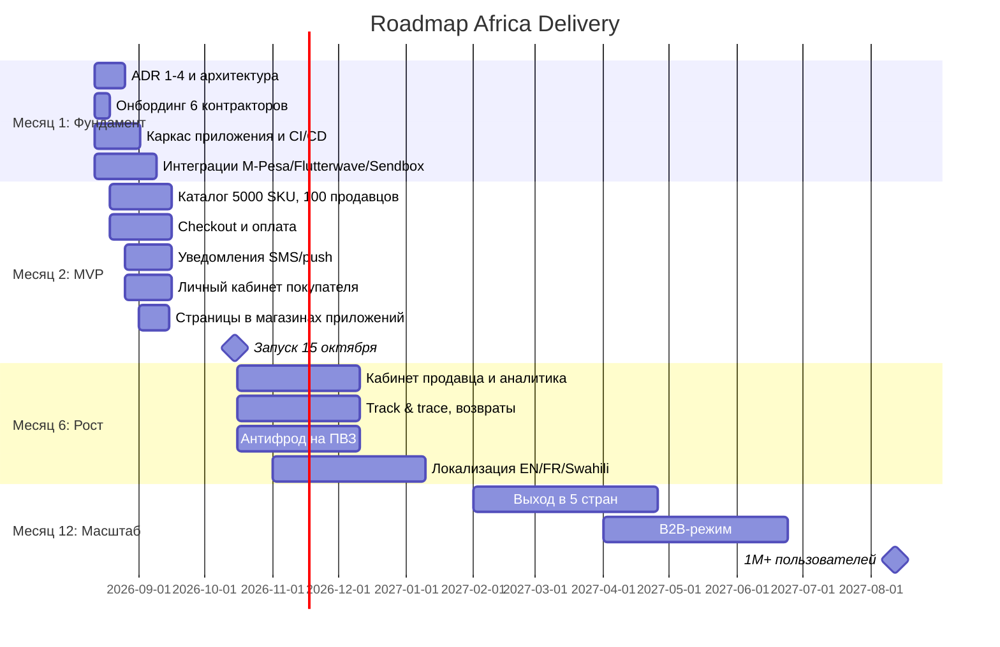

# Roadmap — Africa Delivery

Четыре контрольные точки. Отражение в виде Gantt — на рисунке `roadmap.png` (исходник `roadmap.puml`), ниже — Mermaid-версия.

## Контрольные точки

| Точка | Scope | Команда | Инфраструктурная стоимость |
|---|---|---|---|
| Месяц 1 (12 авг – 12 сен) | ADR 1–4, каркас, CI/CD, старт интеграций | 6 контракторов (архитектор + 5 инженеров) | ~$2–3k/мес (разработка) |
| Месяц 2 / MVP (15 октября) | Каталог 5000 SKU, заказ, оплата M-Pesa/Flutterwave, уведомления, кабинет покупателя, дашборд | 6 контракторов | $4k/мес (в бюджете $5k) |
| Месяц 6 | Кабинет продавца, track & trace, возвраты, антифрод ПВЗ, локализация | 6 контракторов + возможен найм | ~$6–8k/мес (рост с бизнесом) |
| Месяц 12 | 5 стран, B2B, 1M+ пользователей | Команда растёт по выручке | Масштабируется с GMV |

## Что сокращено из списка Product Manager

Из 29 функций в MVP вошли единицы: каталог, поиск, заказ, оплата, уведомления, кабинет покупателя, базовая аналитика. Остальные 20+ (голосовой поиск, ИИ-рекомендации, live-стримы, мультивалютный кошелёк, блокчейн, B2B, dark mode и т.д.) — отложены.

Критерий отбора: в MVP входит только то, без чего сделка «покупатель → оплата → доставка» физически не проходит. Всё, что улучшает, но не разблокирует сделку, — в бэклог.
